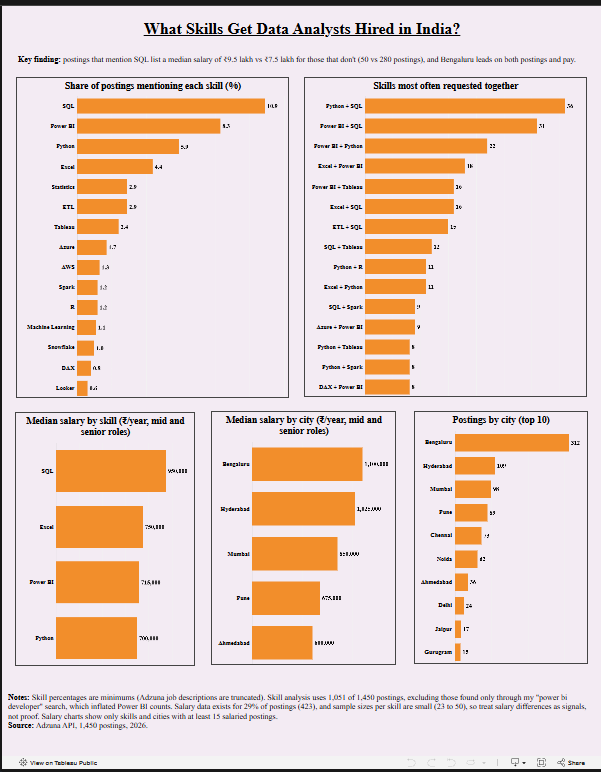

# What Skills Get Data Analysts Hired in India?

An end-to-end analysis of 1,450 real data-analyst job postings from India, built with **Python, SQL, Excel, Power BI and Tableau**.

**Business question:** Which skills, cities and experience levels have the most demand and the best pay, and what should someone learn first?

## Dashboards

| Tool | Link / preview |
|---|---|
| Tableau Public (storytelling view) | [Open the dashboard](https://public.tableau.com/app/profile/nirmala.kanchumarthi/viz/DataAnalystJobsIndia/Dashboard) |
| Power BI (exploration view) | Screenshots in `/dashboard` |



## Key findings

- **SQL is the most requested skill** (10.9% of postings in the skill sample), ahead of Power BI (8.3%), Python (5.9%) and Excel (4.4%).
- **Postings that mention SQL list higher pay:** median ₹9.5 lakh vs ₹7.5 lakh for those that don't (50 vs 280 postings with a salary).
- **Most common skill pairs:** Python + SQL (36 postings) and Power BI + SQL (31).
- **Bengaluru leads on both volume and pay:** 312 postings and a ₹11 lakh median (98 postings with a salary), followed by Hyderabad (₹10.25 lakh), Mumbai (₹8.5 lakh), Pune (₹6.75 lakh) and Ahmedabad (₹6 lakh).

Salary medians cover **mid and senior roles only**, and show only skills and cities with at least 15 salaried postings. Treat the salary gaps as signals, not proof.

## A bias I found in my own data

One of my four search queries was "power bi developer". It inflated Power BI to 281 mentions (#1). After excluding postings found only through that query, Power BI dropped to 87 mentions and **SQL became #1**. All skill-demand results use this corrected sample of 1,051 postings.

## Pipeline

```
Adzuna API -> Python (collect + clean) -> SQLite (queries) -> Excel (cross-check) -> Power BI + Tableau
```

1. **Collect (Python):** 1,769 raw postings from the Adzuna API (4 search queries).
2. **Clean (Python):** removed duplicates (1,450 left), standardised cities (Bengaluru/Bangalore etc.), rolled neighbourhoods up to cities, parsed salaries, extracted 15 skills by keyword matching.
3. **Analyse (SQL):** 7 queries using joins, CTEs, `RANK()`, `LAG()`, a self-join for skill pairs, and a median built with window functions (SQLite has no `MEDIAN`). See `queries.sql`.
4. **Validate (Excel):** pivot tables and formulas reproduced the city counts, the Bengaluru median salary and the sample size. All matched the SQL results.
5. **Visualise:** a 3-page Power BI report and a Tableau dashboard.

## Data quality decisions

- 34% of postings list no city (only "India"), so they are labelled `Unspecified` and left out of city charts.
- Only 29% of postings (423) have a salary. Missing salaries were **not** filled in.
- 24 salaries were flagged as statistical outliers, not deleted. Most were senior roles in plausible ranges.
- Only 6 entry-level postings have a salary, so entry-level salary analysis was not attempted.
- Experience level is guessed from job titles, so it is approximate.

## Limitations

- Adzuna returns truncated descriptions, so skill percentages are **minimums**. They are good for comparing skills with each other, not as absolute numbers.
- The `salary_is_predicted` field was 0 everywhere, including rows with no salary, so I could not confirm the salaries are all employer-stated.
- Postings that mention SQL may also differ in seniority and city, so the salary gap is not a causal effect.
- Posting counts by month mostly reflect which listings were still live when I collected the data, so I did not treat them as a demand trend.

## Reproduce it

```
pip install requests pandas
# get a free API key at developer.adzuna.com, then set:
#   ADZUNA_APP_ID and ADZUNA_APP_KEY (environment variables)

python 01_collect_and_clean.py
python 02_finalize_clean.py
python 04_fix_neighborhoods.py
python 03_load_sqlite.py
python 05_export_city_counts.py
```

API keys are read from environment variables and are never stored in the code.

## Repository structure

```
01_collect_and_clean.py     collect and clean postings
02_finalize_clean.py        city fix, salary checks, outlier flags, bias check
03_load_sqlite.py           build SQLite DB and run queries.sql
04_fix_neighborhoods.py     roll neighbourhoods up to cities
05_export_city_counts.py    city posting counts for Tableau
queries.sql                 the 7 analysis queries
data/query_results/         aggregated results used by the dashboards
dashboard/                  Power BI file, PDF and screenshots
```

Raw and row-level posting data are not included in this repository, in line with the data provider's terms. Run the scripts with your own API key to recreate them.

## Source

Adzuna API (India), 1,450 postings after de-duplication.
